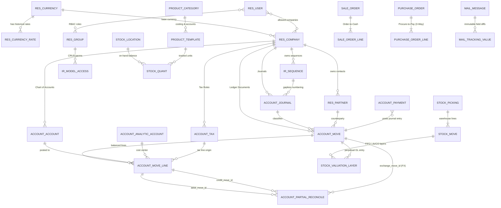

# Nizamo ERP — Architecture & Financial Systems Blueprint

## 1. Architectural Philosophy

**Nizamo ERP** is modeled directly on **Odoo's core architectural patterns** and IFRS/GAAP double-entry accounting standards:

1. **Zero Floating-Point Arithmetic**: Every monetary figure, exchange rate, quantity, tax rate, and cost layer is stored in PostgreSQL as `NUMERIC(19, 6)` (`DECIMAL(19, 6)`) via `backend/core/decimal_utils.py::FixedDecimal` and computed strictly in Python `decimal.Decimal` with explicit `ROUND_HALF_UP` rounding tied to each currency's `decimal_places`.
2. **ACID Concurrency & Row Locking**: Critical mutations (gapless document sequence allocation, journal entry posting, payment reconciliation, stock quant updates, and FIFO valuation layer consumption) execute under PostgreSQL `SELECT ... FOR UPDATE` locks (`apply_for_update` + `atomic_lock`).
3. **Unified Accounting Document Engine**: General Journal Entries (`entry`), Customer Invoices (`out_invoice`), Vendor Bills (`in_invoice`), Credit Notes (`out_refund`, `in_refund`), and Payment Entries all share a single double-entry engine (`account_move` & `account_move_line`).
4. **Modular Plugin Kernel (`backend/core/registry.py`)**: Each business module declares a `__manifest__.py` (`name`, `version`, `depends`, `data`, `installable`, `security_rules`). At startup, Kahn's topological sort resolves dependency order (`accounting` → `inventory` → `sales`, `purchase`), loading ORM models, FastAPI routers, security rules, and seed hooks cleanly.

---

## 2. Database Entity Relationship Diagram (ERD)

---

## 3. Double-Entry Ledger Invariants (`backend/modules/accounting/`)

### 3.1 Posting Invariants (`posting_engine.py`)
Every `DRAFT -> POSTED` transition acquires a row lock (`SELECT ... FOR UPDATE`) and enforces:
- **Strict Balance Check**: $\sum \text{debit} == \sum \text{credit} > 0$ in base `company_currency_id`. Any 1-cent imbalance raises `UnbalancedMoveError`.
- **Posted Immutability**: Once `state == POSTED`, any attempt to update, delete, or cancel the move or its lines raises `PostedImmutabilityError`. Corrections MUST occur via `reverse_move()`, which generates a linked Reversal Entry or Credit Note.
- **Fiscal & Tax Lock Dates**: Rejects posting entries dated on or before `res_company.fiscalyear_lock_date` (or `tax_lock_date` for tax-bearing entries) via `FiscalLockDateError`.
- **Gapless Sequences**: Assigns sequential document codes atomically via `ir_sequence` (`INV/2026/00001`, `BILL/2026/00001`, `JE/2026/00001`).

### 3.2 Multi-Currency & Realized FX Gain/Loss (`reconciliation.py`)
Each `account_move_line` stores both:
- `amount_currency` in transaction `currency_id`
- `debit`, `credit`, `balance = debit - credit` in `company.currency_id`, converted using the latest `res_currency_rate` with `effective_date <= move.date`.

When reconciling a foreign-currency invoice line against a payment line dated at a different exchange rate:
1. The engine computes the matched foreign amount and compares its historical base value on the debit vs. credit line.
2. Any non-zero difference automatically generates and posts a balanced **Realized Foreign Exchange Gain (`490000`)** or **Realized Foreign Exchange Loss (`590000`)** journal entry linked to `account_partial_reconcile.exchange_move_id`.
3. Both the foreign-currency residual and base-currency residual settle cleanly to `0.00`, preserving strict Balance Sheet equilibrium.

---

## 4. Perpetual Inventory Valuation & Accounting Matrix (`backend/modules/inventory/`)

Stock is modeled strictly as **double-entry movements** (`source_location -= qty`, `dest_location += qty`) so $\sum \text{StockQuant.quantity} == 0$ globally across physical (`WH/Stock`) and virtual (`Vendors`, `Customers`, `Inventory Loss`) locations.

| Event | Stock Movement | Costing Rule | Automated GL Entry (`REAL_TIME`) |
|---|---|---|---|
| **Purchase Receipt** (`WH/IN`) | `Vendors -> WH/Stock` | **AVCO**: recalculates weighted avg `standard_price` **FIFO**: appends chronological `StockValuationLayer` **STANDARD**: uses fixed `standard_price` | **Dr** `120000` Inventory Valuation **Cr** `215000` Stock Interim (Received) |
| **Vendor Bill** (3-Way Matched) | — | Validates `Billed <= Received <= Ordered` | **Dr** `215000` Stock Interim (Received) **Dr** `135000` Input VAT **Cr** `200000` Accounts Payable |
| **Customer Delivery** (`WH/OUT`) | `WH/Stock -> Customers` | **FIFO**: consumes oldest layers with `remaining_qty > 0` **AVCO / STANDARD**: values at current `standard_price` | **Dr** `500000` Cost of Goods Sold (COGS) **Cr** `120000` Inventory Valuation |
| **Customer Invoice** | — | Based on `ORDERED` or `DELIVERED` policy | **Dr** `110000` Accounts Receivable **Cr** `400000` Sales Revenue **Cr** `220000` Output VAT |

---

## 5. Multi-Company Isolation, RBAC & Audit Chatter

- **Multi-Company (`X-Company-Id`)**: Every transactional and master table inherits `CompanyScopedMixin` (`company_id`). `get_current_context` validates that non-admin users only query companies in `user.allowed_company_ids`.
- **Model-Level CRUD ACLs (`ir_model_access`)**: Granular `perm_read`, `perm_write`, `perm_create`, `perm_unlink` assigned to roles (`System Admin`, `Accountant`, `Billing Officer`, `Sales User`, `Inventory Manager`).
- **Audit Chatter (`mail_message` & `mail_tracking_value`)**: Every document creation, workflow state transition, field edit, and user note appends an immutable audit record visible inside `ChatterPanel.tsx`.
